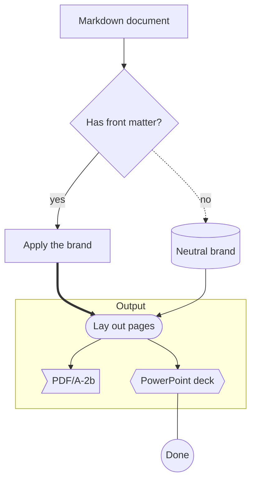
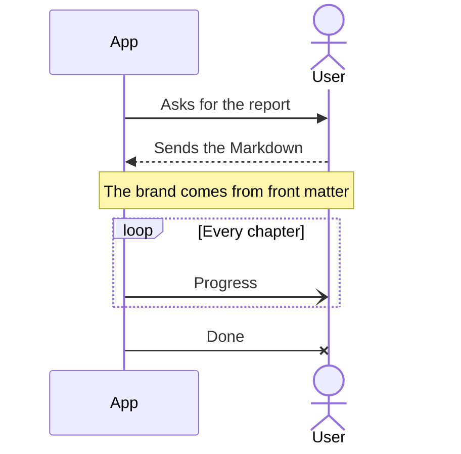
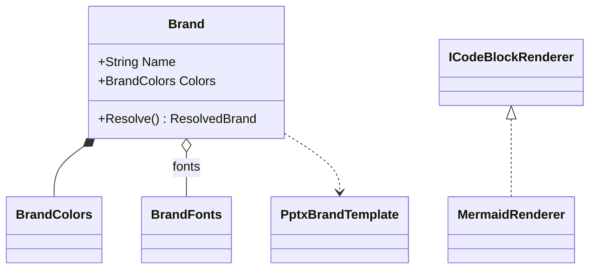
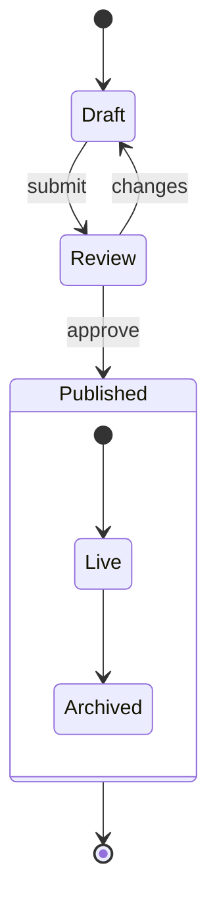
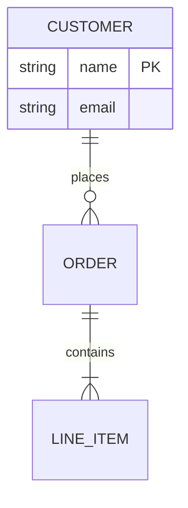
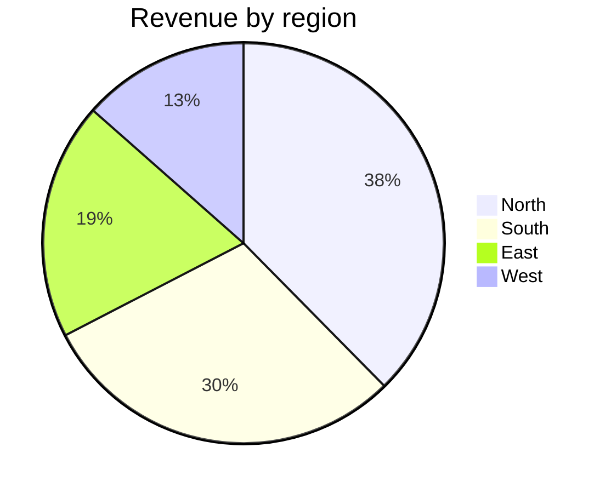
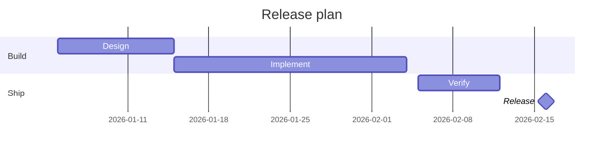
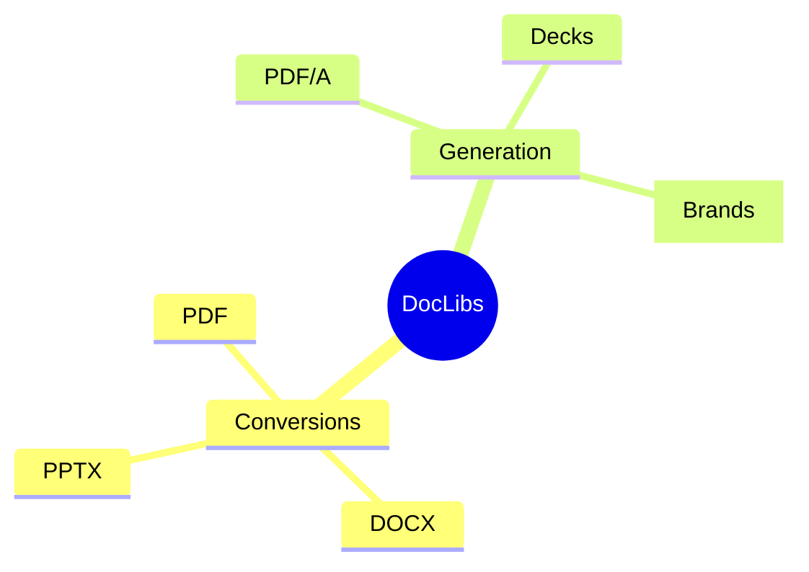
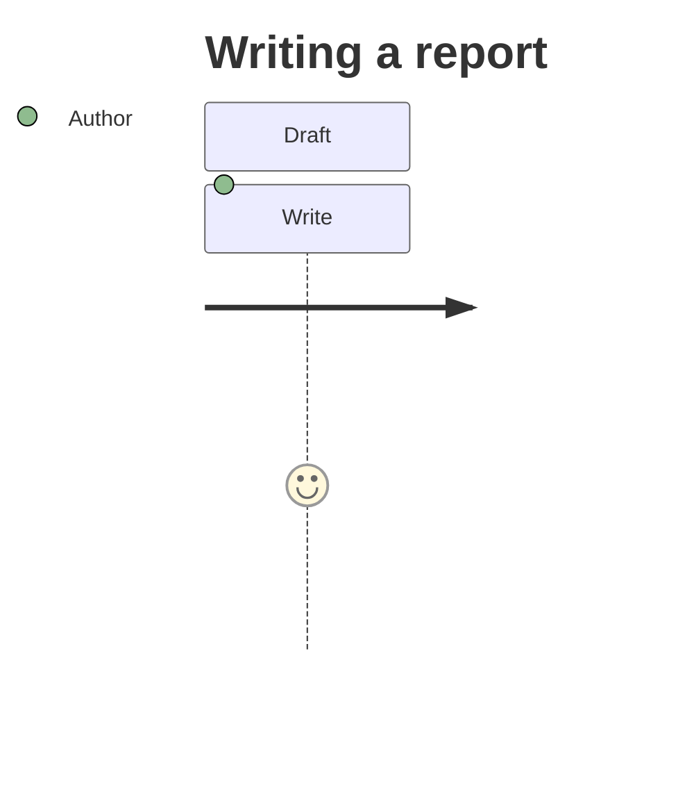

# Diagrams

Every Mermaid diagram type the renderer draws, in the brand's colours and font.

## Flowchart

## Sequence

## Class

## State

## Entity relationship

## Pie

## Gantt

## Mindmap

## Not drawn yet

A journey stays code:

