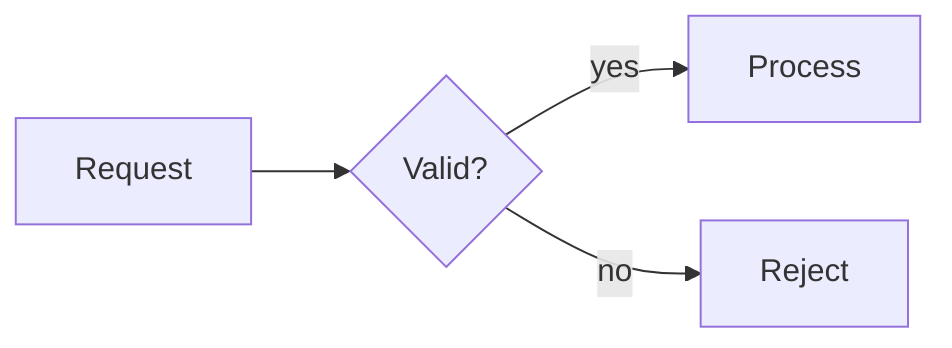

## Diagrams

A ` ```mermaid ` code block becomes a diagram in the document's colours. Use one where a picture
says more than bullets: a process, a sequence of calls, a data model, a plan. Do not add diagrams
by default.

````markdown

````

- **Drawn:** `flowchart` (or `graph`, subgraphs included), `sequenceDiagram`, `classDiagram`,
  `stateDiagram-v2`, `erDiagram`, `pie`, `gantt`, `mindmap`.
- **Not drawn:** every other type (`journey`, `timeline`, `gitGraph`, C4, `xychart`, …) stays a
  code block. Do not use them.
- Keep diagrams small: up to about 12 nodes, short labels. A wide diagram is scaled down to fit,
  text included, and becomes hard to read.
- Mermaid's `click` links, icons and `classDef` styling are not drawn; colours come from the
  design.
- {{errors}}
