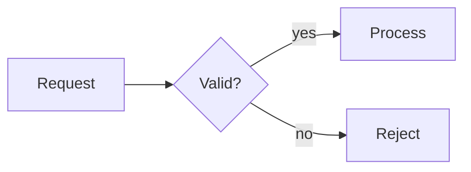

## Writing Markdown for a Word document

The Word document is generated from Markdown: the design (styles, fonts, logo, header and footer,
page numbers) comes from the template, applied for you. Write it as a document to read: full
sentences and paragraphs, headings that say what a section is about.

## Structure

| Markdown | Becomes |
| -------- | ------- |
| A `#` heading as the very first line | The cover page. The paragraphs below it, up to the next heading, are the subtitle; the author and the date follow. Without it, there is no cover. |
| The highest heading level after the cover | Heading 1, and each level below it the next heading style: with `#` chapters, `#` is Heading 1 and `##` Heading 2; with only `##` sections, `##` is Heading 1. |
| A later `#` heading | Starts a new page. |
| Text before the first heading | Normal text on the first page; the document then has no cover. |

- Every paragraph uses a style of the template. Do not try to format text by other means; bold,
  italic and strike-through are the only formatting inside a paragraph.
- A skipped level never shows as 0 where headings are numbered: a `###` right under a `#` is
  `1.1`, and `##` sections before the first `#` are `1`, `2`. Still, write headings in order.

## Heading numbers

Headings of the first three levels are numbered `1`, `1.1`, `1.1.1`; deeper ones are not. `headingNumbers: false` in the front matter removes the numbers.

- `{.unnumbered}` at the end of a heading gives it no number, and it does not count:
  `## Preface {.unnumbered}`.

## Table of contents

`toc: true` in the front matter puts a table of contents after the cover, on a page of its own,
headed "Contents" in the document's language (`lang`). It lists the headings down to the level
`tocDepth` gives (default `2`), with their numbers. Each entry links to its heading. Word fills in
the page numbers when the document is opened; the headings are listed even where nothing updates
it.

## Text, lists and quotes

| Markdown | Becomes |
| -------- | ------- |
| `**bold**`, `*italic*`, `~~strike~~` | Bold, italic, struck-through text. |
| `` `code` `` | Inline code in the code font. |
| `[text](https://example.com)` | A link. `[text](#heading-id)` jumps to a heading of the document; its id is the heading text in lower case, spaces as `-`. Other links stay text. |
| `- item`, `1. item` | Bulleted and numbered lists, nested up to three levels. Each numbered list starts at its own first number. |
| `- [ ] task`, `- [x] done` | Task items with a check box that can be ticked in Word. |
| `Term` and a line `:   description` | A definition list: the term in bold, the description indented below it. |
| `> quote` | A quote; quotes inside quotes are shown as one. |
| A fenced code block | Code in the code font, line by line. |
| `---` | A horizontal rule. |
| `Text[^1]` and `[^1]: Note.` | A footnote at the foot of the page, numbered by Word. |

- Lists nested deeper than three levels are set at the third level.
- HTML is not interpreted: it is shown as text.

## Tables

- A table spans the width of the text. Each column is at least as wide as its longest word; the
  rest is shared by how much each column holds.
- The first row is the header, repeated at the top of every page the table runs onto.
- Alignment from the separator row (`:---`, `:---:`, `---:`) is kept.
- A paragraph of nothing but bold text right before a table is the table's title:
  `**Sales by region**`.
- A paragraph starting `Table: ` right after a table, after a blank line (without one the table is
  not a table), is its caption, numbered through the document and set above the table: `Table: Sales in 2026` gives
  "Table 1: Sales in 2026". The label is in the document's language; `Table:` itself stays
  English.
- A `Table: ` paragraph anywhere else is shown as text.

## Images

- `` places the image centred in a paragraph of its own, at its natural size,
  made smaller to fit the page, never larger. `"scale=0.5"` in the title scales it first. Always
  write alt text.
- The image's title is its caption, numbered through the document and set below it:
  `` gives "Figure 1: Sales by region, 2026".
  `"caption"` alone uses the alt text as the caption. A title of only `scale=…` gives no caption.
- Images are PNG, JPEG or GIF, or SVG: an `.svg` image keeps its SVG, which Word draws sharp
  at any size.
  `fit=`, `focus`, `.round` and `.grey` have no effect in a Word document.

- A paragraph of nothing but two or more images is a row of them, side by side in cells of equal
  width, each with its caption under it: ` `.

## Syntax written for slides

Markdown written for slides works here too, so one text can serve a deck and a document. Each piece
takes a style of its own; the content of a container follows in sequence.

| Markdown | Becomes |
| -------- | ------- |
| `> [!NOTE]`, `[!TIP]`, `[!IMPORTANT]`, `[!WARNING]`, `[!CAUTION]` | A block with a bar on the left, starting with its title in bold in the document's language. Important, warning and caution are in the highlight colour. |
| `::: cards` with a `### Title` before each card | Each title a small bold heading, not numbered and not in the table of contents; a paragraph of only bold text right under it is the card's figure, set large. |
| `::: cards` or `::: rows` around a list of `- **Title** – text` | Each title in bold, its text indented under it, as a definition list. |
| `::: panel` … `:::` | Its paragraphs in one shaded box; `::: panel dark` in the primary colour with white text. Lists and tables inside keep their own look. |
| `::: statement` … `:::` | The first paragraph large and bold; the rest as usual. |
| `::: columns` … `:::` | The columns one after the other. |
| `` `tag` `other` `` (a paragraph of only code spans) | Tags: small grey chips in the code font. |
| `==marked==` | Bold on a light tint of the highlight colour. A table row whose first cell is all `==…==` is shaded. |
| `[words]{.success}` (`.info`, `.warning`, `.danger`, `.neutral`) | The words bold in that colour. |
| A table cell that is only `` `Done` ``, with `labels.success: Done` in the front matter | A coloured label. Code in cells no `labels.` key names stays code. |
| `::: conclusion`, `::: comment` | Their content in sequence. |
| `## Title {kicker="…" layout="…"}`, `{.dark}`, transitions, `::: notes`, build markers | Checked as in decks, then left out. |

Unknown containers, alerts and heading attributes are errors.

## Diagrams, charts and QR codes

A code block of a kind described below becomes a chart or a picture; any other stays code.

- **Charts** (`chart` blocks, where described below) are native Word charts as wide as the
  text, whose data can be edited in Word.
- **Diagrams** and other drawings are pictures, made smaller to fit the page, never larger;
  their alt text is the block's first line.
- **Captions:** a paragraph starting `Figure: ` right after a drawn block is its caption,
  numbered with the images and set below it: `Figure: Order flow` gives "Figure 2: Order flow".
  After anything else it is shown as text.
- **QR codes:** `` is a QR code of the text after `qr:` (at
  most 1 000 characters; shorter addresses scan better). `"scale=2"` in the title enlarges it,
  `"caption"` puts the alt text under it.
- **Timelines and Gantt charts:** `::: timeline` around a list of 2–8
  `- **date** Title: description`; `::: gantt` around a table of 1–20 rows of task, start and
  end (no end: a milestone). Dates: `2026`, `2026-Q2`, `2026-03`, `2026-03-15`; what ended
  before today is grey. `today=2026-11-01` after the name pins today;
  `grid=week|month|quarter` sets a Gantt's grid.
- **Steps and risk matrices:** `::: steps` around a list of 2–7 `- **Title** – description`
  draws chevrons in a row, `{.current}` at the end of one item marks it. `::: riskmatrix`
  around a table of 1–15 rows of risk, likelihood and impact (each 1–5) puts numbered dots on
  a 5 × 5 grid.

````markdown
## Plan

::: timeline
- **2026-01** Start
- **2026-06** Go-live: all regions
:::

::: riskmatrix
| Risk | Likelihood | Impact |
| ---- | ---------- | ------ |
| Supplier delay | 4 | 3 |
:::
````

## Icons

`:icon-name:` draws the icon of that name of [Tabler Icons](https://tabler.io/icons) (3.52.0, outline), such as `:icon-circle-check:`. A Word document draws it in the line of text, one line high. An unknown name is an error.

Common: `check`, `x`, `star`, `heart`, `bolt`, `rocket`, `target`, `flag`, `bulb`, `lock`, `users`, `calendar`, `clock`, `mail`, `chart-bar`, `trending-up`, `cloud`, `search`, `settings`, `world`.

## Diagrams

A ` ```mermaid ` code block becomes a diagram in the document's colours; in a Word document, a
picture. Use one where a picture says more than bullets: a process, a sequence of calls, a data
model, a plan. Do not add diagrams by default.

````markdown

````

- **Drawn:** `flowchart` (or `graph`, subgraphs included), `sequenceDiagram`, `classDiagram`,
  `stateDiagram-v2`, `erDiagram`, `pie`, `gantt`, `mindmap`.
- **Not drawn:** every other type (`journey`, `timeline`, `gitGraph`, C4, `xychart`, …) stays a
  code block. Do not use them.
- Keep diagrams small: up to about 12 nodes, short labels. A wide diagram is scaled down to fit,
  text included, and becomes hard to read.
- Mermaid's `click` links, icons and `classDef` styling are not drawn; colours come from the
  design.
- A diagram with a syntax error is an error naming the line of its block; fix the Mermaid and try again.

## Charts

A code block with the language `chart` becomes a chart in the design's colours: bars, lines or areas,
as a native chart whose data can be edited in decks and Word documents, and drawn in PDFs.
Settings come first, one `key: value` per line, then a line `---`, then the data as CSV: a header
row (the name of the category column, then one name per series) and one row per category.

````markdown
```chart
type: bar
title: Orders by month
unit: k
source: Sales report 2026
---
month, plan, actual
Jan, 120, 132
Feb, 118, 121
Mar, 125, 140
```
````

- **Settings:** `type` is `bar` (the default), `line` or `area`; `stacked: true` stacks bars or areas;
  `title` and `unit` are optional. `source` names where the data comes from: it is shown under the
  chart as "Source: …", the word in the document's language (`lang`).
- **Values** are plain numbers with a decimal point and no thousands separator (`1250.5`); an empty
  cell leaves a gap. Up to about twelve categories and five series stay readable.
- **Semicolons:** CSV whose header row is separated by `;`, as a spreadsheet in a German locale
  exports it, is split at `;` throughout, and its numbers have a decimal comma (`1250,5`). A `.` in
  such a number is an error: remove the thousands separator. `decimal: point` (or `decimal: comma`)
  overrides the decimal mark for either separator.

  ````markdown
  ```chart
  source: Controlling
  ---
  Monat; Plan; Ist
  Jan; 120,5; 132
  Feb; 118; 121,25
  ```
  ````

- A chart is placed like an image: it fills the room it has. Two charts side by side: `::: columns`
  with a chart in each column.
- A mistake in the settings or the data is an error naming the line of its block.

### Financial charts

A code block with the language `financial-chart` holds one of the charts of a performance review as
JSON: `development`, `growth-by-row`, `actual-vs-reference`, `growth-trend`, `two-year` or
`summary-table`. Growth rates and shares are fractions (`0.05` is 5 %); `lastActual` counts months
from 0. These blocks are usually written by a program, not by hand.

````markdown
```financial-chart
{
  "type": "growth-trend",
  "title": "Orders growth",
  "lastActual": 2,
  "reference": 0.05,
  "months": [
    { "label": "Jan", "change": 0.056 }, { "label": "Feb", "change": 0.054 }, { "label": "Mar", "change": 0.04 },
    { "label": "Apr", "change": 0.045 }, { "label": "May", "change": 0.05 }
  ],
  "options": { "labels": { "current": "This year", "previous": "Last year", "projection": "Forecast" } }
}
```
````

- **Options:** `culture` (`pl-PL` writes `5,2%`), `scale` and `unit` (`1000000` and `M`), `labels`
  (`previous`, `current`, `reference`, `projection`, `estimate`, `change`, `overall`, `value`).
- A misspelt property or invalid JSON is an error naming the line of its block.

## Page breaks

`::: pagebreak` on a line of its own, closed by `:::`, starts a new page with what follows. It may
hold content, which then starts the new page, and its closing `:::` may be left out. `{.newpage}` at
the end of any heading starts a new page with that heading: `## Appendix {.newpage}`. A later `#`
already starts a page. No break makes an empty page, and the cover heading takes no `{.newpage}`.

```markdown
::: pagebreak
:::

## Appendix
```

## Classification

`classification: internal` or `classification: confidential` in the front matter puts "Internal" or
"Confidential" (in the document's language) in the header of every page and above the cover title,
and into the document's properties. `draft: true` adds "Draft" and a watermark on every page. The
host may already mark the document; the front matter can raise its classification, not lower it.

## Front matter

Settings go in a block at the very top, before anything else. One `key: value` per line, no
nesting and no lists. Leave out what the defaults already do: every key is optional.

```markdown
---
title: Network expansion 2027
author: Planning team
---
```

| Key | Values |
| --- | ------ |
| `title` | The document title in the file's properties. Default: the first `#` heading. |
| `author` | The author in the file's properties. |
| `lang` | The document language, such as `en`, `de` or `de-CH`: of the texts the generator writes itself, and of spell checking. Default `en`. |
| `typography` | `true` sets typographic quotes, dashes, `…` and no-break spaces (`10 km`) for the language; type straight quotes. Default `false`. |
| `template` | The design: `neutral` or `sample`. |
| `showDate` | `true` or `false`: today's date on the cover and in the footer. Default `true`. |
| `showTagline` | `true` or `false`: the design's tagline on the cover, if it has one. Default `true`. |
| `embedFonts` | `true` or `false`. Leave it out: by default the document carries its fonts. |
| `toc` | `true` or `false`: a table of contents after the cover. Default `false`. |
| `tocDepth` | `1`, `2` or `3`: the heading levels the table of contents lists. Default `2`. |
| `headingNumbers` | `true` or `false`: numbers on the first three heading levels (1, 1.1, 1.1.1). Default `true`. |
| `justify` | `true` or `false`: body text justified, without hyphenation. Default `false`. |
| `classification` | `public`, `internal` or `confidential`: the marking in the header of every page and above the cover title. Default `public`, which shows nothing. |
| `draft` | `true` or `false`: `true` adds "Draft" to the marking and a watermark to every page. Default `false`. |
| `transition`, `build`, `numberChapters` | Settings for decks. A Word document accepts them and ignores them. |
| `labels.success`, `labels.info`, `labels.warning`, `labels.danger`, `labels.neutral` | Status labels, separated by `;`: a table cell that is only one of them, as code (`` `Done` ``), is shown as a coloured label. |

An unknown key, a key given twice or an invalid value is an error that lists the valid keys.

## Characters

The document is set in Liberation Serif. A character this font lacks is shown in a substitute font and looks out of place. Leave out emoji, and write these symbols as shown:

| Avoid | Write instead |
| ----- | ------------- |
| ✓ (fine in code) | `[x]` |
| ✔ (fine in code) | `[x]` |
| ✗ (fine in code) | `[ ]` |
| ✘ (fine in code) | `[ ]` |
| ☐ | `[ ]` |
| ☑ | `[x]` |
| ■ (in code only) | `•` |
| □ (in code only) | `•` |
| ▪ (in code only) | `•` |
| ◦ (in code only) | `–` |
| ★ | `*` |
| ☆ | `*` |
| ▲ (in code only) | `↑` |
| ▼ (in code only) | `↓` |
| ► (in code only) | `→` |
| ◄ (in code only) | `←` |
| ⇒ | `→` |
| ⇐ | `←` |
| ⇔ (in code only) | `↔` |
| ≡ (in code only) | `=` |
| ‖ (in code only) | `\|` |

## Limits

A check before generating reports what goes beyond these: at most 150 words in a paragraph; at most 60 characters in a heading; alt text for every image. Keep to them from the start.

## When something is wrong

Generation stops with a message that says what to fix, such as a front matter key that does not
exist or a value it does not take, an image that is missing, or a broken diagram or chart with its line.
Fix the Markdown and generate again.

## Notes you may get back

The document is still written, but whoever passes it to you may also pass on notes about it, each with its line. Each names what happened:

- `code-not-drawn`: a diagram could not be drawn, for example a diagram type that is not supported, and stays code. Use a supported type. In a Word document, diagrams, QR codes and drawn containers become pictures only where an image converter is set up; without one they stay code, alt text or their content. Ask whoever generates the document to set one up.
- `html-as-text`: HTML is not interpreted: it is shown as text. Write Markdown instead.
- `footnote-missing`: a footnote reference such as `[^1]` has no definition `[^1]: text`, so it is shown as written. Add the definition, or remove the reference.
- `language-unknown`: the language in `lang` has no texts of its own, so alert titles and similar texts are in English. Use `en` or `de`.
- `attribute-ignored`: an image attribute has no effect here, for example `fit=cover` on an image of its own in a PDF, or `focus` on an image that is not cropped. Remove it, or use it where it works.
- `icon-not-drawn`: an icon was left out where it cannot be drawn. Move it as the *Icons* section says. In a Word document, icons are drawn only where an image converter is set up, and are left out otherwise.
- `caption-ignored`: a `Table: …` or `Figure: …` paragraph does not directly follow a table or a drawn diagram, so it is shown as text. Move it right after its table, or write it as ordinary text.
- `list-too-deep`: a list is nested deeper than three levels; the deeper items are set at the third level. Flatten the list to three levels.
- `classification-kept`: front matter cannot lower the host's `classification`, which applies. Leave the key out.
- `typography-skipped`: with `typography: true`, a character the fonts lack was kept as typed. Nothing to fix.

A check before generating writes nothing and returns these notes too, and also:

- `long-paragraph`: a paragraph has more words than *Limits* allows. Split it, or make a list of it.
- `title-too-long`: a title or heading is longer than *Limits* allows. Shorten it; the detail goes in the text.
- `alt-text-missing`: an image has no alt text. Say what it shows: ``.
- `image-source`: an image is not among the files given to you, or is a web address or `data:` URL, which is never loaded. Use only the paths you were given.

## Example

````markdown
---
title: Network expansion 2027
toc: true
---

# Network expansion 2027

Status report for the steering committee, October

## Summary

The upgrade is on schedule: 14 of 20 substations are done.[^permits] The budget is on track.

## Sites

**Substations by region**

| Region | Done | Planned |
| :----- | ---: | ------: |
| North | 8 | 10 |
| South | 6 | 10 |

Table: Progress at the end of October

## Next steps

> [!IMPORTANT]
> The southern permits decide the date of commissioning.

1. Obtain the remaining permits in the first quarter.
2. Commission the last sites.

- [x] Budget approved
- [ ] Permits for the southern sites

[^permits]: Two sites are delayed by permits.
````
