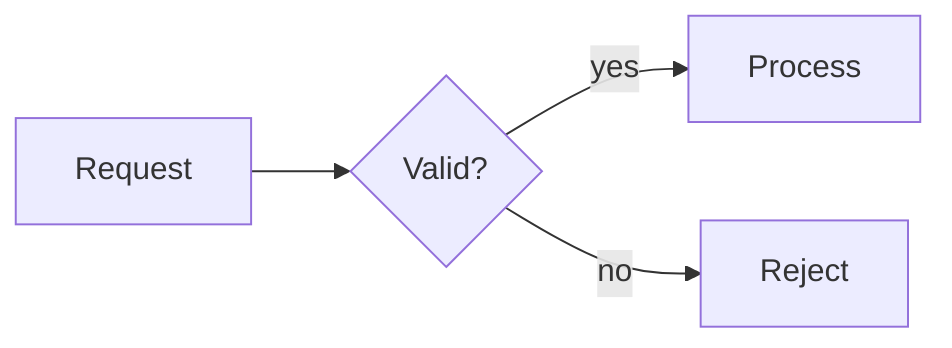
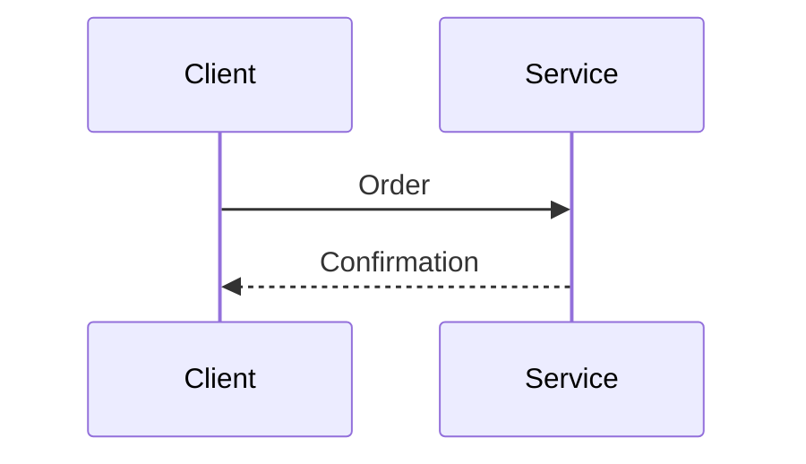

# Drawings in Word

## Charts

```chart
type: bar
title: Orders by month
unit: k
source: Sales report 2026
---
month, plan, actual
Jan, 120, 132
Feb, 118, 121
Mar, 125, 140
```

Figure: Orders against the plan

```chart
type: line
---
month, north, south
Jan, 12, 9
Feb, 14, 11
Mar, 13, 15
Apr, 16, 14
```

```chart
type: area
stacked: true
title: Capacity
---
quarter, base, extra
Q1, 40, 10
Q2, 42, 14
Q3, 45, 12
```

## Diagrams



Figure: How a request is handled



```financial-chart
{
  "type": "growth-trend",
  "title": "Orders growth",
  "lastActual": 2,
  "reference": 0.05,
  "months": [
    { "label": "Jan", "change": 0.056 }, { "label": "Feb", "change": 0.054 }, { "label": "Mar", "change": 0.04 },
    { "label": "Apr", "change": 0.045 }, { "label": "May", "change": 0.05 }
  ]
}
```

## Images and codes


Status :icon-circle-check: done, :icon-alert-triangle: at risk.

- :icon-rocket: Launch
- :icon-calendar: Plan

## Plans

::: timeline today=2026-04-01
- **2026-01** Start: kick-off
- **2026-03** Pilot
- **2026-06** Go-live: all regions
:::

::: gantt today=2026-04-01 grid=month
| Task | Start | End |
| ---- | ----- | --- |
| Build | 2026-02 | 2026-05 |
| Launch | 2026-06 | |
:::

::: steps
- **Analyse** – understand the current process
- **Design** – agree the target picture {.current}
- **Build**
:::

::: riskmatrix
| Risk | Likelihood | Impact |
| ---- | ---------- | ------ |
| Supplier delay | 4 | 3 |
| Key person leaves | 2 | 5 |
:::
