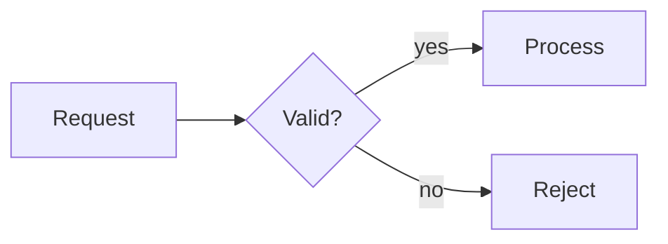

## Writing Markdown for a PDF

The PDF is generated from Markdown: the design (colours, fonts, logo, header and footer, page
numbers) is applied for you. Write it as a document to read: full sentences and paragraphs,
headings that say what a section is about, lists where items really are parallel.

## Structure

| Markdown | Becomes |
| -------- | ------- |
| A `#` heading as the very first line | The cover page. The paragraphs below it, up to the next heading, are the subtitle. Without it, there is no cover. |
| Every other `#` heading | A heading that starts a new page. |
| `##` to `######` | Headings, in the table of contents (bookmarks), kept on a page with what follows them. |
| `---` | A thin line. |
| Text before the first heading | Normal text on the first page; the document then has no cover. |

- Paragraphs are left-aligned and broken at spaces; a line break is `\` at the end of a line.
- Lists nest with indentation; `1.` lists are numbered from their first number.
- `**bold**`, `*italic*`, `~~strike~~`, `` `code` `` and links work. A link needs an absolute URL
  (`https://…`) or a heading anchor (`[see costs](#costs)`); anything else stays text.
- `[words]{.success}` sets a few words bold in a status colour: `.success`, `.info`, `.warning`,
  `.danger` or `.neutral`.
- A quote (`>`) is indented and grey. A code block is set in a monospace font on a grey
  background, long lines wrapped.
- **Tables** span the page width; columns get the room their content needs, alignment follows the
  `:--`/`--:` markers. Long tables continue on the next page with the header row repeated. Keep
  them to about six columns: wider tables squeeze their words.
- **Images** (PNG or JPEG) are referenced by the path given to you, keep their size and are only
  scaled down to fit; `` halves the size. They are never split and
  move to the next page if needed. Several images in one paragraph stand side by side, equally
  wide.
- **Image attributes** in braces right after an image, without a space:
  `{.round .grey}`. `.round` crops it to a circle, `.grey` shows it in grey,
  `scale=0.5` is the same as `"scale=0.5"`. In a row of images, `fit=cover` fills the row's height
  and crops what sticks out, and `focus=top`, `bottom`, `left`, `right` or `center` (the default)
  says which part stays; an image of its own is never cropped. An unknown attribute is an error.
- **Footnotes:** `[^1]` in the text and `[^1]: The note.` on a line of its own anywhere below.
  The reference becomes a small raised number; the notes are listed at the end of the document,
  numbered in the order they are referenced. A reference without its definition stays as written.
- **Task lists:** `- [ ] open` and `- [x] done` get an empty or ticked box instead of a bullet.
- **Definition lists:** a term on a line of its own, then `:   ` and its description on the next
  line (several `:` lines for several descriptions). The term is set in bold, the description
  indented under it.
- HTML is printed as text, not interpreted: do not use it. HTML comments are dropped.

## Syntax written for slides

Markdown written for decks works here too and is shown plainly, so one text can serve both:
`## Title {kicker="…"}` drops the attributes, `::: cards`, `rows`, `panel`, `statement` and
`columns` show their content as normal text, one part after the other, `==marked==` text is bold, and an alert (`> [!NOTE]`, `[!TIP]`,
`[!IMPORTANT]`, `[!WARNING]`, `[!CAUTION]`) is a quote that starts with its title in bold, in the
document's language (`lang`). Speaker notes (`::: notes` … `:::`) and transitions (`transition:`
in the front matter, `transition="…"` on a heading) are left out. For a
PDF alone, write plain Markdown; alerts are fine for notes and warnings. Unknown containers,
attributes, alerts and transitions are errors, as in decks, and so is a `::: notes` inside another
block.

## Diagrams

A ` ```mermaid ` code block becomes a diagram in the document's colours. Use one where a picture
says more than bullets: a process, a sequence of calls, a data model, a plan. Do not add diagrams
by default.

````markdown

````

- **Drawn:** `flowchart` (or `graph`, subgraphs included), `sequenceDiagram`, `classDiagram`,
  `stateDiagram-v2`, `erDiagram`, `pie`, `gantt`, `mindmap`.
- **Not drawn:** every other type (`journey`, `timeline`, `gitGraph`, C4, `xychart`, …) stays a
  code block. Do not use them.
- Keep diagrams small: up to about 12 nodes, short labels. A wide diagram is scaled down to fit,
  text included, and becomes hard to read.
- Mermaid's `click` links, icons and `classDef` styling are not drawn; colours come from the
  design.
- A diagram with a syntax error is an error naming the line of its block; fix the Mermaid and try again.

## Front matter

Settings go in a block at the very top, before anything else. One `key: value` per line, no
nesting and no lists. Leave out what the defaults already do: every key is optional.

```markdown
---
title: Network expansion 2027
author: Planning team
---
```

| Key | Values |
| --- | ------ |
| `title` | The document title in the file's properties. Default: the first `#` heading. |
| `author` | The author in the file's properties. |
| `lang` | The document language, such as `en`, `de` or `de-CH`: of the texts the generator writes itself, and of spell checking. Default `en`. |
| `template` | The design: `neutral` or `sample`. |
| `showDate` | `true` or `false`: today's date in the footer. Default `true`. |
| `showTagline` | `true` or `false`: the design's tagline on the cover, if it has one. Default `true`. |
| `pageSize` | `A4`, `A3` or `Letter`. Default `A4`. |
| `orientation` | `portrait` or `landscape`. Default `portrait`. |
| `transition` | The transition between slides in a deck: `none`, `fade`, `push`, `wipe`, `split`, `cover`, `uncover`, `zoom`, `cut`, `morph`. A PDF accepts it and ignores it. |
| `labels.success`, `labels.info`, `labels.warning`, `labels.danger`, `labels.neutral` | Status labels for decks, separated by `;`. A PDF accepts them and shows the labels as code. |

An unknown key, a key given twice or an invalid value is an error that lists the valid keys.

## Characters

The fonts are embedded in the PDF and have no emoji and no Asian scripts; never use emoji. Any character the fonts lack stops the generation with an error naming it. Write these symbols as shown:

| Avoid | Write instead |
| ----- | ------------- |
| ✓ (fine in code) | `[x]` |
| ✔ (fine in code) | `[x]` |
| ✗ (fine in code) | `[ ]` |
| ✘ (fine in code) | `[ ]` |
| ☐ | `[ ]` |
| ☑ | `[x]` |
| ● (fine in code) | `•` |
| ○ (fine in code) | `•` |
| ■ | `•` |
| □ | `•` |
| ▪ | `•` |
| ◦ | `–` |
| ★ | `*` |
| ☆ | `*` |
| → (fine in code) | `->` |
| ← (fine in code) | `<-` |
| ↔ (fine in code) | `<->` |
| ↑ (fine in code) | `up` |
| ↓ (fine in code) | `down` |
| ▲ | `up` |
| ▼ | `down` |
| ► | `->` |
| ◄ | `<-` |
| ⇒ | `->` |
| ⇐ | `<-` |
| ⇔ | `<->` |
| ≡ | `=` |
| ‖ | `\|` |
| ─ (fine in code) | `-` |
| │ (fine in code) | `\|` |

## When something is wrong

Generation stops with a message that says what to fix: a character the fonts lack, an image that
is not among the files, a front matter key that does not exist, or a broken diagram with its line.
Fix the Markdown and generate again.

## Notes you may get back

The document is still written, but whoever passes it to you may also pass on notes about it, each with its line. Each names what happened:

- `code-not-drawn`: a diagram could not be drawn, for example a diagram type that is not supported, and stays code. Use a supported type.
- `html-as-text`: HTML is not interpreted: it is shown as text. Write Markdown instead.
- `footnote-missing`: a footnote reference such as `[^1]` has no definition `[^1]: text`, so it is shown as written. Add the definition, or remove the reference.
- `language-unknown`: the language in `lang` has no texts of its own, so alert titles and similar texts are in English. Use `en` or `de`.
- `attribute-ignored`: an image attribute has no effect here, for example `fit=cover` on an image of its own in a PDF, or `focus` on an image that is not cropped. Remove it, or use it where it works.

## Example

````markdown
---
title: Network expansion 2027
---

# Network expansion 2027

Status report for the steering committee, October

## Summary

The upgrade is on schedule: 14 of 20 substations are done. Two sites are delayed by permits, and
the budget is on track.

## Progress

| Site group | Done | Open |
| ---------- | ---: | ---: |
| North | 8 | 1 |
| South | 6 | 5 |

> [!WARNING]
> The permits for the last two sites are still missing. Without them, commissioning moves to Q3.

## Next steps

1. Obtain the remaining permits (Q1).
2. Commission the last sites (Q2).
````
