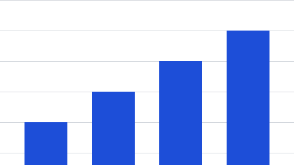
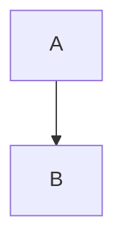

# Quarterly review

Generated from **Markdown** for the DocLibs team.

## Summary

Plain paragraph with **bold**, *italic*, ***bold italic***, `code`, ~~struck~~ and a
[link](https://example.com). An internal link goes to the [results](#results). German and Polish
text: Größe, Übermaß, Zażółć gęślą jaźń, 12 € — and Czech: Příliš žluťoučký kůň.

- First bullet
  - Nested bullet
    - Third level
- Second bullet\
  with a hard break

3. Third item
4. Fourth item
   1. Nested numbered

### A sub-heading

> A quoted remark that is long enough to wrap onto a second line, so the rule on the left runs
> along both lines.

```csharp
var answer = 42;
Console.WriteLine($"The answer is {answer}.");
```

---

## Results

Numbers for the quarter:

| Region | Revenue | Change |
| :----- | ------: | :----: |
| North  | 1,200   | +4 %   |
| South  | 950     | -2 %   |

Figures are preliminary.



#### Fourth level

##### Fifth level

###### Sixth level

# Outlook

What comes next.


