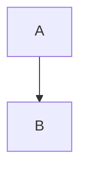

Text before the first heading is ignored.

# Quarterly review

Generated from **Markdown**

## Agenda

Plain paragraph with **bold**, *italic*, `code`, ~~struck~~ and a [link](https://example.com).

- First bullet
  - Nested bullet
    - Third level
- Second bullet\
  with a hard break

3. Third item
4. Fourth item
   1. Nested numbered

### A sub-heading

> A quoted remark.

```csharp
var answer = 42;
```

## Results

Numbers for the quarter:

| Region | Revenue | Change |
| :----- | ------: | :----: |
| North  | 1,200   | +4 %   |
| South  | 950     | -2 %   |

Figures are preliminary.

## Diagram

The chart below shows the trend.


Source: made-up data.

## Two pictures


Between the pictures.


## Flow



# Outlook

What comes next

## Closing
